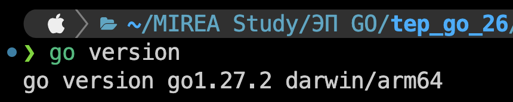
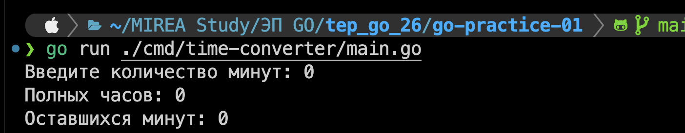
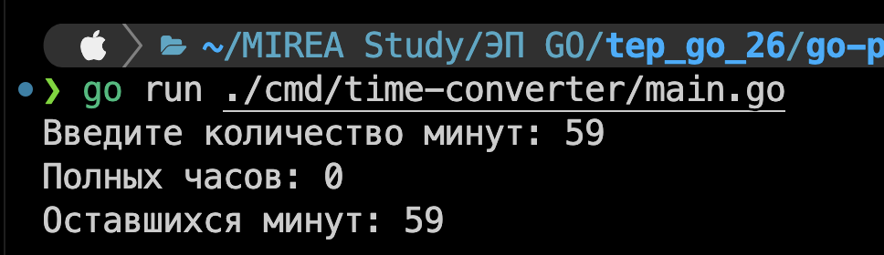
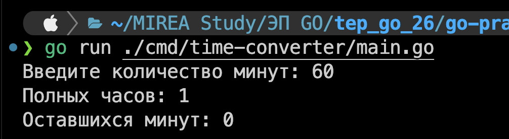
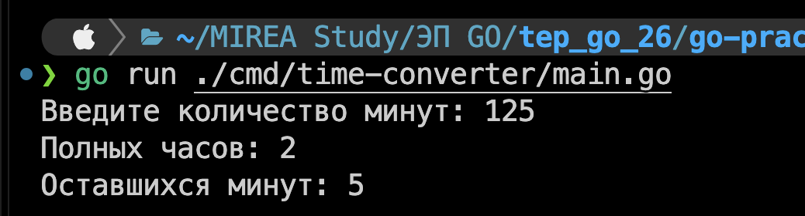
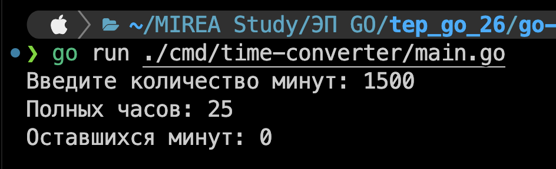
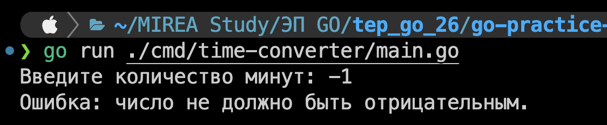
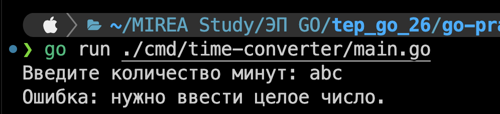
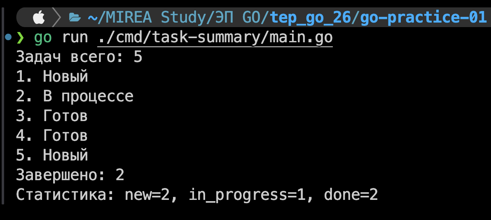

# Практическая 1

## Версия GO



## Команды запуска

> [!IMPORTANT]  
> **Все команды указаны из корня практической 1, перейти в нее:**

```bash
cd go-practice-01
```

### Hello program

```bash
go run ./main.go
```

```bash
go build -o hello.test .         
./hello
```

### Card

```bash
go run ./cmd/card/main.go
```

### Experiments

```bash
go run ./cmd/experiments/main.go
```

### time-converter

```bash
go run ./cmd/time-converter/main.go
```

## Скриншоты тестов конвертера










# Практическая 2

## Что добавлено

Добавлена программа task-summary. В ней использовались циклы, условия, словари и срезы.

## Команды запуска

> [!IMPORTANT]  
> **Проверьте, что находитесь в go-practice-01:**

```bash
pwd
```

Перейти в неё, если не в ней:

```bash
cd go-practice-01
```

### Task summary

```bash
go run ./cmd/task-summary/main.go
```

## Результат выполнения:

